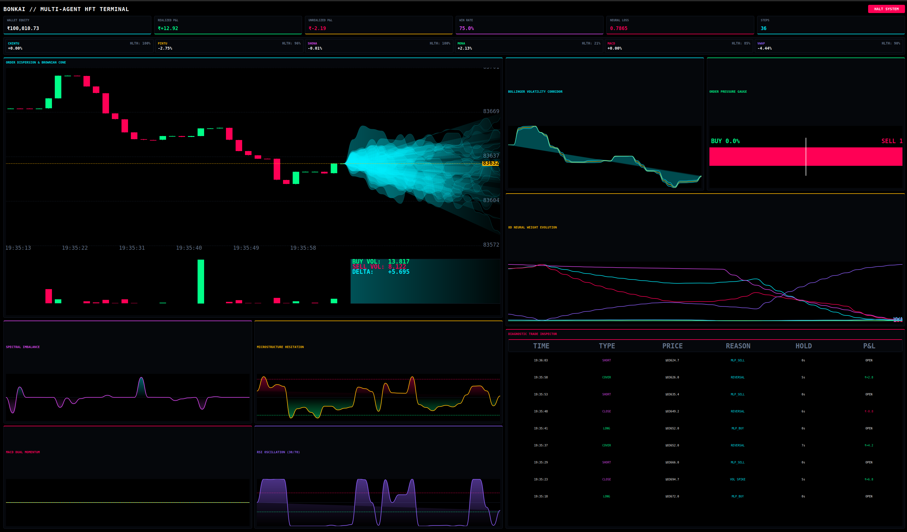

# Bonkai HFT Dashboard

I wanted to build something that bridges the gap between theoretical particle physics and live market chaos. Markets look random on the surface, just like particles colliding inside a detector, yet beneath the noise lie measurable forces, momentum, and probability distributions. Here is the exact mathematical and computational engine powering those neon charts on your screen.

***

### 1. The Eight Dimensional Phase Space (Neural Core)

In physics, you never describe a moving particle using position alone; you map its full state vector in phase space. This terminal treats price the exact same way. Instead of staring blindly at raw candles, a fast feedforward Multilayer Perceptron (MLP) ingests an eight dimensional microstructure state vector $\mathbf{x}_t \in \mathbb{R}^8$ at every single tick and maps it through nonlinear activation layers:

$$\hat{y}_t = \tanh\Big(W_2 \cdot \text{ReLU}(W_1 \mathbf{x}_t + \mathbf{b}_1) + b_2\Big)$$

Every dimension captures a distinct physical property of order flow:

* **Rolling Z Score:** Measures how many standard deviations the current price $P_t$ has drifted away from its fifty tick equilibrium mean $\mu_{50}$, calculated as:

$$Z_t = \frac{P_t - \mu_{50}}{\sigma_{50}}$$

* **Log Tick Return:** Captures instantaneous price velocity through natural log differences, keeping returns additive and symmetric across time:

$$r_t = \ln\left(\frac{P_t}{P_{t-1}}\right)$$

* **Volume Delta:** Measures net directional force by subtracting aggressive market sell volume from aggressive market buy volume:

$$\Delta V_t = V_{\text{buy}} - V_{\text{sell}}$$

* **Normalized MACD:** Tracks momentum acceleration using the spread between fast and slow exponential moving averages, scaled to keep neural network gradients clean and stable.
* **Normalized RSI:** Rescales the classic Relative Strength Index into a centered range so the network immediately spots overextended kinetic energy.
* **Bollinger Percent B:** Acts like a Hookean restoring spring force, signaling when stretched prices are ready to snap back toward equilibrium:

$$\%B = \frac{P_t - B_{\text{lower}}}{B_{\text{upper}} - B_{\text{lower}}}$$

* **VWAP Distance:** Computes relative displacement from the volume weighted center of mass, showing whether buyers or sellers control true liquidity:

$$D_{\text{VWAP}} = \frac{P_t - \text{VWAP}}{\text{VWAP}}$$

* **Turbulence Proxy (ATR Volatility):** Uses normalized Average True Range to gauge local market temperature and scale decision sensitivity during heavy volatility.

***

### 2. Stochastic Brownian Motion Cones

This is where statistical mechanics takes center stage. Just like pollen grains jittering under constant molecular bombardment in Einstein's classic fluid model, asset prices undergo continuous random walks driven by thousands of competing orders.

We model future price diffusion using Geometric Brownian Motion (GBM), governed by the stochastic differential equation:

$$dS_t = \mu S_t \, dt + \sigma S_t \, dW_t$$

Here, $\mu$ represents local drift, $\sigma$ is the rolling lognormal volatility estimated from recent tick returns, and $dW_t$ is a standard Wiener process increment. Applying Ito's Lemma gives the exact analytical path evolution over a forward time horizon $\Delta t$:

$$S_{t+\Delta t} = S_t \exp\left( \left(\mu - \frac{1}{2}\sigma^2\right)\Delta t + \sigma \sqrt{\Delta t} \, \epsilon \right), \quad \epsilon \sim \mathcal{N}(0, 1)$$

At every frame, the dashboard calculates the live diffusion variance $\sigma^2 \Delta t$ and projects multipath confidence cones ($1\sigma$ and $2\sigma$ probability envelopes) forward in time. Before the neural network ever commits capital, you get a glowing visual map of where price is statistically likely to diffuse next.

***

### 3. Live Computation Pipeline and Combat Logic

Speed and memory efficiency keep the whole system alive. Rather than recalculating heavy historical arrays from scratch, the backend ingests streaming WebSocket tick packets into fixed length circular buffers, updating rolling means, variances, and indicators in $O(1)$ constant time.

Once the neural output $\hat{y}_t \in [-1, +1]$ fires, execution follows strict threshold physics:

* **LONG Ignition:** When $\hat{y}_t > +\theta_{\text{entry}}$, upward order flow pressure crosses the activation barrier and the terminal fires a **LONG** position.
* **SHORT Ignition:** When $\hat{y}_t < -\theta_{\text{entry}}$, downward momentum dominates and the engine flips **SHORT**.

The moment a trade goes live, an automated risk shield locks onto the position. Take Profit targets, dynamic Trailing Stops, and Hard Stops scale automatically using live ATR volatility so stops breathe naturally with market noise. Finally, a Z Score anomaly circuit breaker ($|Z_t| > Z_{\text{crit}}$) acts as an emergency reactor scram switch: if a sudden flash spike distorts market geometry, it overrides all signals and ejects immediately to protect wallet equity.
